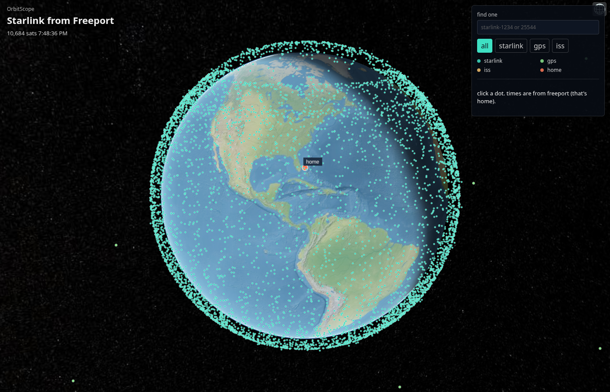

# OrbitScope

Sophomore CS project.

Before this, the only app I made myself was a calculator in JavaFX. This is a lot bigger. I did **not** write the orbit math. A library called Orekit does that. The 3D earth is another library (Cesium). My code mostly glues them together:

1. download the satellite list (TLE files from CelesTrak)
2. ask Orekit where each one is
3. draw a dot on the globe

I live in Freeport, Bahamas, so that's the default location. Click a satellite and it tells you when it goes over home.



## How to run

Need Java 21 and Node.

```bash
./run.sh api     # java server, http://localhost:8080
./run.sh web     # globe page,  http://localhost:5173
```

Open the second one. If the page says it can't load, I probably forgot to start the api.

Click a dot = name + altitude + next pass over Freeport. The search box and the four buttons just hide some of the dots.

## Little programs I wrote while learning

I left these in because that's how I learned Java (same way I learned JavaFX — tiny programs first).

```bash
./run.sh hello      # System.out.println
./run.sh warmup     # arrays + a Satellite class
./run.sh file       # read data/sample-starlink.tle
./run.sh fetch      # download live names
./run.sh iss        # check my ISS numbers vs the internet
./run.sh test
```

First time you run anything with Orekit it downloads a zip of data files into `orekit-data/`. That folder is not in git. If it's missing, Orekit crashes with a weird UTC error. That's normal. Run it again.

## Did I get the math right?

I can't check 10,000 Starlinks by hand. I did check the ISS against https://wheretheiss.at at the same time. About 0.2 km off. Good enough for me.

CelesTrak won't send the file unless the User-Agent looks real. Default Java gets an empty page. Took me a while.

## Speed

I don't have a graphics card. I timed "move a bunch of satellites forward" three ways:

- Orekit, 1 core: 405 ms
- Orekit, 4 cores: 165 ms
- my simpler version with arrays: 4 ms (less accurate, ignores drag)

The globe still uses Orekit. The array version is just me seeing if it would be faster. Notes: [docs/benchmark.md](docs/benchmark.md)

## Folders

```
src/main/java/orbitscope   java
web/                       the globe page (javascript/typescript)
data/                      sample satellite files
NOTES.md                   stuff I keep forgetting
```

## Website

I have not put this online yet. There's a Dockerfile if I do. Then I'd link it from njoku.dev.
