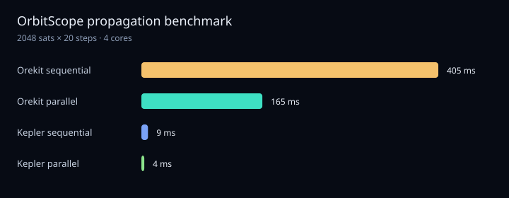
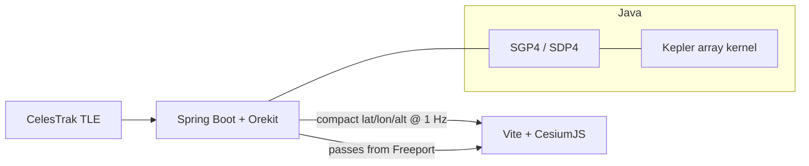

# OrbitScope

A live 3D globe of Starlink, GPS, and the ISS. A Java / Orekit backend does the orbit math; a Cesium frontend draws a dot for every satellite and updates it every second.

**Done-checks already run on this machine**

- ISS vs [wheretheiss.at](https://wheretheiss.at): **0.2 km**
- Compact position feed: **~10k satellites**
- Kepler kernel vs sequential SGP4: **101×** (see [docs/benchmark.md](docs/benchmark.md))

## Demo

```bash
./run.sh api          # Java API on http://localhost:8080
./run.sh web          # globe on http://localhost:5173
```

Open http://localhost:5173. Cyan dots are Starlink, green is GPS, gold is the ISS, orange is Freeport, Bahamas. Click a dot for NORAD id, altitude, and the next pass over Freeport. Filter chips and the search box hide everyone else.


JSON without the globe:

- http://localhost:8080/api
- http://localhost:8080/satellites
- http://localhost:8080/satellites/25544/position
- http://localhost:8080/satellites/25544/passes
- http://localhost:8080/satellites/positions/compact



## Architecture



## Setup

You need **Java 21** and **Node 22**. Maven is `./mvnw`.

```bash
./run.sh test         # Java tests
./run.sh iss          # ISS vs public tracker
./run.sh bench        # CPU vs Kepler timing
./run.sh api          # backend
./run.sh web          # frontend (npm install happens here)
```

The first orbit-math run downloads [Orekit data](https://gitlab.orekit.org/orekit/orekit-data/-/archive/main/orekit-data-main.zip) into `orekit-data/` (gitignored).

## Milestones

| Week | Milestone | Where it lives |
| --- | --- | --- |
| 0 | First program | `HelloOrbitScope` |
| 1–2 | Arrays, `Satellite`, list methods | `Warmup` |
| 3 | TLE file + HTTP | `TleParser`, `TleFetcher` |
| 4–5 | Orekit lat/lon/alt | `PositionCalculator`, `IssCheck` |
| 6–7 | Spring Boot JSON + 3 h refresh | `SatelliteController`, `CatalogService` |
| 8–9 | Cesium globe, 1 Hz dots | `web/` |
| 10 | Click, search, Freeport passes | `/satellites/{id}/passes` |
| 11 | Benchmark | `Benchmark`, `docs/benchmark.md` |
| 12 | Ship | `Dockerfile`, `render.yaml`, `web/vercel.json` |

## Deploy

1. Backend: `render.yaml` (Docker) or `fly launch` with the `Dockerfile`. It fetches CelesTrak on boot.
2. Frontend: Vercel from `web/`. Set `VITE_API_URL` to the Render/Fly origin (no trailing slash).
3. Point [njoku.dev](https://njoku.dev) at the Vercel URL.

Local Docker (API + built globe in `static/`):

```bash
docker build -t orbitscope .
docker run -p 8080:8080 orbitscope
```

## Layout

```
src/main/java/orbitscope   Java API, Orekit, Kepler kernel
web/                       TypeScript + Cesium
data/                      sample TLE files
docs/benchmark.md          speedup numbers
NOTES.md                   what I learned
```
